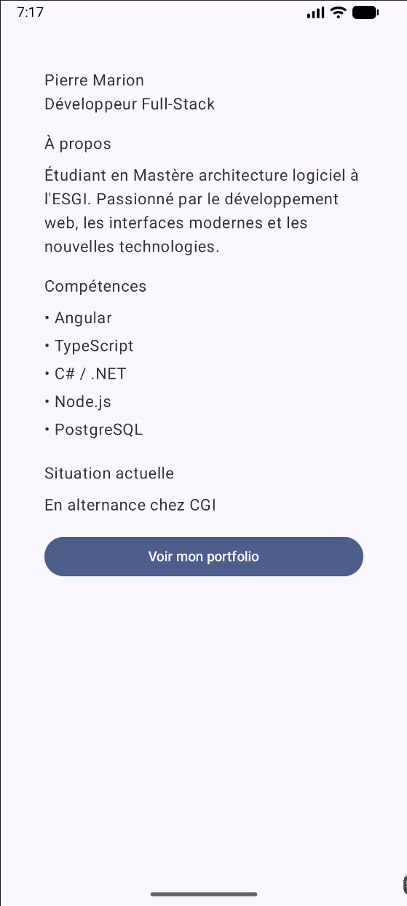

# Profil développeur - Jetpack Compose

## Présentation

Pour ce devoir, j'ai créé une application Android qui affiche une fiche de profil développeur avec Jetpack Compose et Kotlin.

On retrouve le nom, le métier, une petite présentation, les compétences et la situation actuelle. J'ai aussi ajouté un bouton pour le portfolio.

J'ai fait deux profils différents pour tester la réutilisation des composants.

## Technologies et notions utilisées

- Kotlin et Jetpack Compose
- Composables et paramètres
- Modifier et padding
- Column, Surface, Text et Button
- Callbacks
- Previews
- Accessibilité

## Explications

**1. Quels composables avez-vous créés ?**

J'ai créé plusieurs composables : ProfileScreen, ProfileCard, ProfileHeader, ProfileDescription, SkillsSection, SkillItem, ProfileAvailability et ProfileAction.

**2. Quel composable représente l'écran principal ?**

C'est ProfileScreen. Il contient les informations du profil et les passe à ProfileCard.

**3. Où utilisez-vous un padding externe ?**

Dans ProfileScreen, avec un padding de 24.dp pour laisser de l'espace entre la fiche et les bords de l'écran.

**4. Où utilisez-vous un padding interne ?**

Dans ProfileCard, avec un padding de 20.dp pour éviter que le texte soit collé aux bords de la fiche.

**5. Quel composant reçoit un callback ?**

ProfileAction reçoit onActionClick pour gérer le clic sur le bouton. ProfileCard reçoit aussi onProfileClick.

Pour le moment, les clics ne font rien, comme demandé dans le devoir.

**6. Quelle information d'accessibilité avez-vous ajoutée ?**

J'ai utilisé Role.Button et contentDescription pour indiquer que la fiche est cliquable et expliquer son action.

**7. Pourquoi vos composants sont-ils réutilisables ?**

Parce qu'ils utilisent des paramètres. Je peux donc changer le nom, les compétences ou la description sans devoir refaire les composants.

## Aperçu

J'ai créé deux previews : une avec mon profil de développeur full-stack et une autre avec un profil de développeur Android junior.

